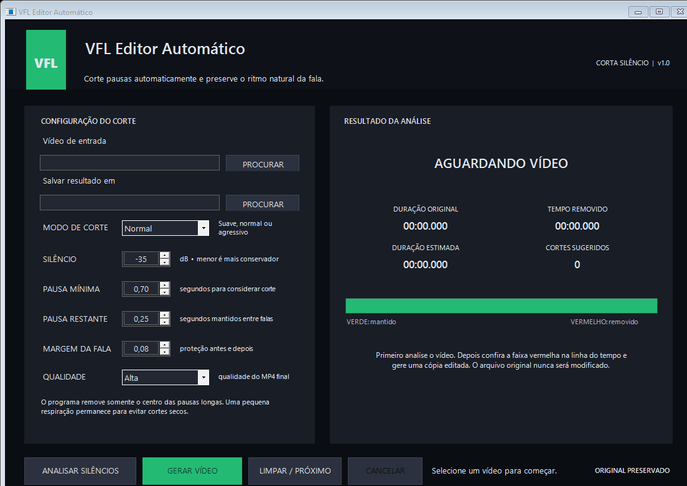

# VFL Editor Automático

Aplicativo Windows que detecta pausas no áudio, remove o centro dos silêncios longos e preserva uma pequena respiração para manter o ritmo natural da fala.



## Principais recursos

- Detecção automática de silêncios no áudio.
- Presets de corte **Suave**, **Normal** e **Agressivo**.
- Ajustes de sensibilidade, pausa mínima, pausa restante e margem da fala.
- Linha do tempo indicando os trechos mantidos e removidos.
- Comparação entre duração original, tempo removido e duração estimada.
- Suporte a vídeos longos com centenas de cortes.
- Qualidade de exportação Rápida, Equilibrada ou Alta.
- Preferências salvas automaticamente.
- FFmpeg e FFprobe portáteis incluídos na distribuição para Windows.
- Processamento totalmente local; o vídeo original nunca é alterado.

## Como usar

1. Baixe o ZIP na seção **Releases** e extraia a pasta inteira.
2. Abra `VFL.EditorAutomatico.exe`.
3. Selecione o vídeo que deseja editar.
4. Comece pelo modo **Normal** e confira a análise.
5. Ajuste os parâmetros se quiser um resultado mais suave ou agressivo.
6. Clique em **Gerar vídeo**.

O resultado é salvo em um novo MP4 com o sufixo `_SEM_SILENCIOS`. O arquivo original é preservado.

## Configuração padrão da versão 1.0

- Modo: Normal
- Silêncio: `-35 dB`
- Pausa mínima: `0,70 s`
- Pausa restante: `0,25 s`
- Margem da fala: `0,08 s`
- Qualidade: Alta

## Compilar o código

Requisitos para desenvolvimento: Windows e .NET 8 SDK. Para publicar uma distribuição completa, coloque a versão Windows compartilhada do FFmpeg dentro de `Tools` antes de executar:

```powershell
dotnet build -c Release
dotnet publish -c Release -r win-x64 --self-contained true
```

## Licença

Uso pessoal e não comercial permitido. Venda e uso comercial são proibidos sem autorização.

Consulte [LICENSE.md](LICENSE.md) para os termos completos. O FFmpeg incluído mantém sua própria licença GPL; consulte [FFMPEG-NOTICE.md](FFMPEG-NOTICE.md).
